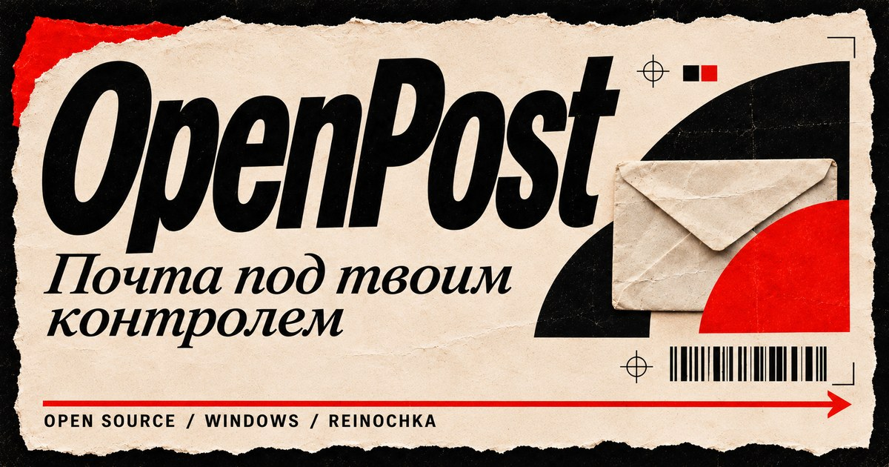
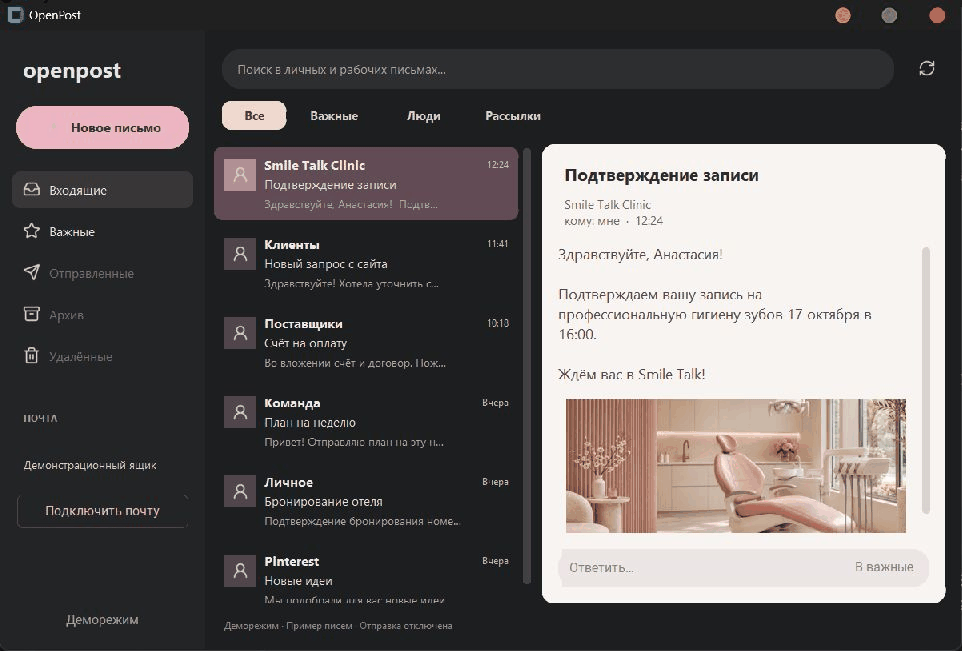

# OpenPost ✉

Настольный почтовый клиент с открытым исходным кодом. Тёмный интерфейс с розовыми акцентами, три колонки и светлая область чтения. Python 3.11+, CustomTkinter и Pillow.



*Демонстрация на вымышленных письмах. Личная почта не подключена, отправка в деморежиме отключена.*

**Входящие · чтение · поиск · важные письма · отправка и ответы.** Один почтовый аккаунт, ваши IMAP/SMTP-серверы.

### Начать за три шага

1. **[Скачать установщик для Windows →](https://github.com/r3in04ka-prog/openpost/releases/latest)** и установить приложение.
2. Нажать **Демо**, чтобы посмотреть интерфейс без аккаунта.
3. Для своей почты нажать **Подключить почту** и ввести IMAP/SMTP-настройки и пароль приложения своего провайдера. OAuth пока не поддерживается.

[Установка и запуск](#запуск) · [Возможности](#возможности) · [Приватность и ограничения](#приватность-и-ограничения) · [Кейс проекта](https://github.com/r3in04ka-prog/r3in04ka-prog/blob/main/cases/openpost.md)

## Запуск

### Windows: установщик

Скачайте установщик **OpenPost-Setup** из [Releases](https://github.com/r3in04ka-prog/openpost/releases/latest) и запустите. Python уже включён. Установка выполняется для текущего пользователя, создаёт пункт меню «Пуск» и по желанию ярлык на рабочем столе. Удаление — через настройки приложений Windows. Сборка для Windows x64, установщик не подписан цифровым сертификатом.

Одновременно поддерживается **один аккаунт**. Подключение другого заменяет текущий; после перезапуска пароль нужно ввести заново.

### Запуск из исходников

Установите Python с поддержкой Tkinter, затем в папке проекта выполните:

```sh
pip install .
python -m openpost
```

На Linux может понадобиться пакет `python3-tk`. На Windows используйте официальный установщик Python с компонентом Tcl/Tk. Альтернативно: `pip install .`, затем `openpost`.

Нажмите **Демо**, чтобы изучить интерфейс без аккаунта. Для своей почты нажмите **Подключить почту** и укажите email, пароль приложения, IMAP-сервер и SMTP-сервер вашего провайдера. IMAP использует TLS на порту 993; SMTP — TLS на 465 либо обязательный STARTTLS на 587. Оба соединения проверяют сертификат и имя сервера.

## Возможности

- Входящие: последние 50 писем, самые новые первыми.
- Чтение текстовых писем и поиск по загруженным отправителям, темам и содержимому.
- Создание и отправка писем, ответы с заголовками In-Reply-To и References.
- Фоновые сетевые операции и деморежим.
- Интерфейс на русском языке.
- Локальные важные письма: кнопка «В важные» и одноимённый фильтр. Список сбрасывается при обновлении писем.
- Фильтры «Люди» и «Рассылки» используют простую эвристику по отправителю и могут ошибаться.

Деморежим показывает вымышленные письма и сгенерированную фотографию клиники. Это иллюстрация внутри приложения; отображение фотографий из настоящих писем пока не поддерживается. Для отправителей используются нейтральные значки, фотографии контактов пока не подключены. Недоступные папки показаны приглушённым цветом и объясняют ограничение при нажатии.

## Приватность и ограничения

Пароль и письма живут только в памяти процесса; приложение не сохраняет их на диск, не ведёт журнал содержимого и не использует аналитику. Это не гарантирует удаления данных из системного файла подкачки или дампов памяти. Серверы почты получают обычные данные для аутентификации и доставки.

HTML не выполняется, внешние изображения не загружаются. Вложения, OAuth, несколько аккаунтов, другие папки, удаление, отметки прочтения и офлайн-хранилище пока не реализованы. Приложение открывает входящие только для чтения. HTML-письма без текстовой части показывают пояснение вместо содержимого.

Используйте провайдера, разрешающего IMAP/SMTP с паролем приложения. Аккаунты, требующие OAuth, пока не поддерживаются. Копия отправленного письма не добавляется в папку «Отправленные» самим клиентом; поведение зависит от сервера. После ошибки отправки сначала проверьте доставку: SMTP мог принять письмо до разрыва соединения. Не запускайте приложение с недоверенными почтовыми серверами.

Это начальная версия, а не готовая замена Thunderbird. Автоматические тесты используют имитацию серверов; реальная доставка требует проверки с вашим аккаунтом.

## Разработка

```sh
python -m unittest discover -s tests -v
python -m compileall -q openpost tests
```

`openpost/mail.py` отвечает за MIME, IMAP и SMTP; `openpost/app.py` — за интерфейс и очередь фоновых задач. Вносите изменения через pull request с описанием поведения и проверки. Не добавляйте настоящие письма, пароли и адреса пользователей в тесты или issues.

Лицензия: MIT. План развития: OAuth, вложения, папки, управление аккаунтами и установочные пакеты.
